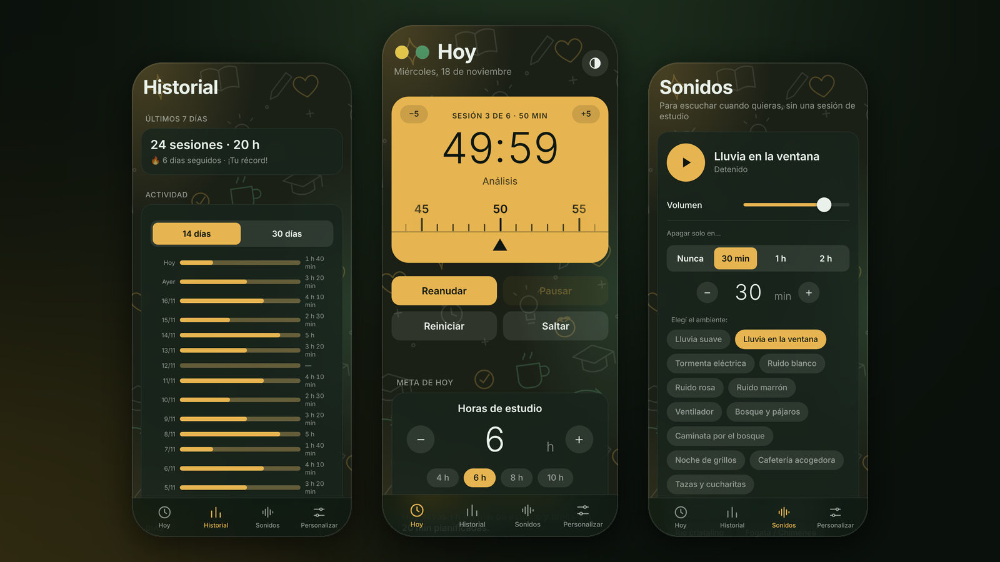

# 🌿 Karu — Temporizador de enfoque y estudio

**Una app Pomodoro tranquila y sin conexión para concentrarte, estudiar mejor y armar tu racha de productividad.**

🌐 [English](README.md) · **Español** · [Português](README.pt.md)

`focus` · `productividad` · `pomodoro` · `temporizador de estudio` · `concentración` · `sonidos ambiente` · `ruido blanco` · `rachas` · `sin conexión` · `sin anuncios` · `Android`

[⬇️ Descargar el APK](../../releases) · [☕ Apoyame en Ko-fi](https://ko-fi.com/karuapp)

---

## ✨ ¿Qué es Karu?

Karu es un temporizador de enfoque pensado para estudiantes y para cualquiera que quiera avanzar sin distracciones. Elegís tu meta del día, Karu arma tu plan de estudio, tocás iniciar y te concentrás, a tu propio ritmo.

**Sin cuentas. Sin anuncios. Sin internet. Tus datos no salen de tu celular.**

## 🚀 Funciones

- ⏱️ **Pomodoro personalizable**: elegí la duración del enfoque, del descanso corto y del largo, o usá un método listo: Clásico (25/5), Largo (50/10) o Anime (20/4).
- 🎯 **Meta diaria de estudio**: decidí cuántas horas querés estudiar hoy y Karu te arma un plan de sesiones. Si le contás tus horarios libres, te dice si tu meta entra.
- 📈 **Historial y rachas**: mirá tus últimos 7, 14 y 30 días, tu racha de días seguidos y tu récord para mantenerte motivado.
- 🌧️ **23 sonidos ambiente**: lluvia en la ventana, tormenta, ruido blanco / rosa / marrón, bosque, cafetería acogedora, biblioteca, olas, fogata, piano y más. Con apagado automático.
- 🕰️ **10 tic-tac y 14 alarmas**, cada uno con su volumen.
- ✅ **Tareas**: creá tareas y asignalas a tus sesiones.
- 💡 **Sugerencias inteligentes**: ritmo de enfoque, mejor horario y meta diaria según lo que estudiás (matemática, memorización, lectura, trabajo creativo, práctica…).
- 🎨 **Hacela tuya**: 20 paletas de color, modo claro/oscuro y colores totalmente personalizables.
- 💾 **Respaldo**: exportá e importá tus datos cuando quieras.
- 🌍 **3 idiomas**: Español, English y Português.
- 🔒 **Privada de verdad**: todo se guarda solo en tu dispositivo.

## 📲 Instalación (Android)

1. Entrá a la página de [Releases](../../releases).
2. Descargá el último archivo `.apk`.
3. Abrilo en tu celular y, si Android lo pide, permití instalar desde orígenes desconocidos.

> 🛒 Mi objetivo es publicar Karu en Google Play. ¡Mientras tanto, el APK es la forma de probarla!

## 🌱 Unas palabras de quien la hizo

¡Hola! Soy **LuKz** y este es uno de mis primeros proyectos. Soy principiante, así que Karu todavía está creciendo y puede tener errores o detalles por pulir. Si encontrás uno, tenés una idea o simplemente querés saludar, abrí un [Issue](../../issues): me encantaría leerte, y que seas amable y constructivo/a significa muchísimo para mí. 💛

## ☕ Apoyá el proyecto

Karu es **100% gratuita, sin anuncios y privada**. Publicarla en Google Play requiere pagar una cuenta de desarrollador que por ahora no puedo cubrir. Si Karu te sirve en tu día a día, podés colaborar acá:

👉 **[ko-fi.com/karuapp](https://ko-fi.com/karuapp)**

¡Compartirla con alguien que estudie también ayuda un montón! ⭐ Una estrella en este repo también suma.

## 📄 Licencia

© 2026 LuKz. Todos los derechos reservados. Por favor, no copies, redistribuyas ni modifiques la app sin permiso.
