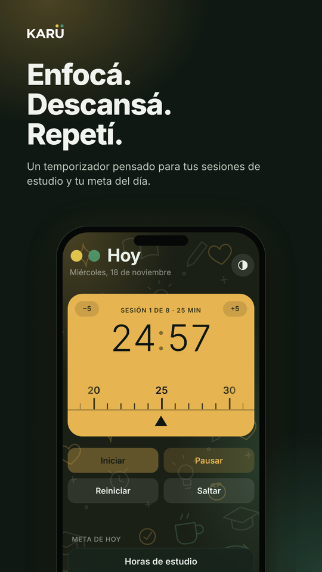
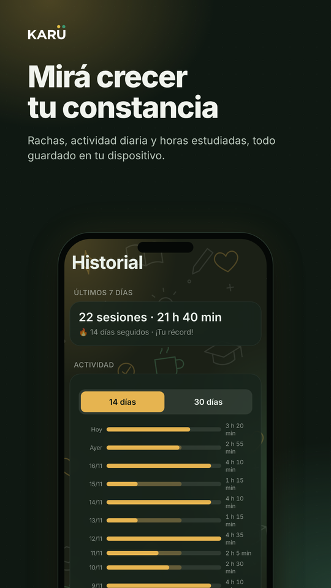
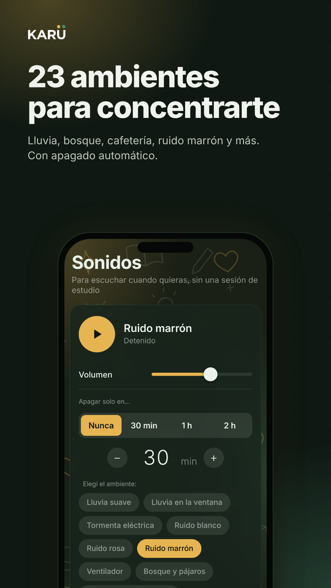
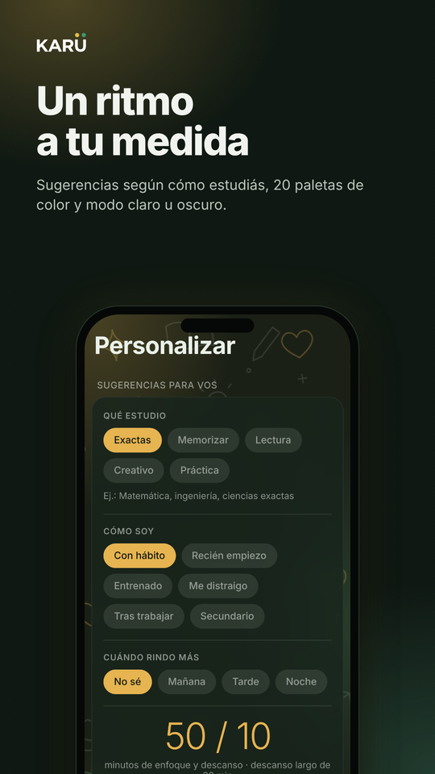

# 🌿 Karu — Temporizador de estudio

**Un Pomodoro tranquilo, sin conexión y sin anuncios, para sentarte a estudiar y no perder la racha.**

🌐 [English](README.md) · **Español** · [Português](README.pt.md)

`focus` · `productividad` · `pomodoro` · `temporizador de estudio` · `concentración` · `sonidos ambiente` · `ruido blanco` · `rachas` · `sin conexión` · `sin anuncios` · `Android`

[⬇️ Descargar el APK](../../releases) · [☕ Apoyame en Ko-fi](https://ko-fi.com/karuapp)

---

## Qué es Karu

Karu es un temporizador para estudiar. Le decís cuántas horas querés estudiar hoy, te arma las sesiones, tocás Iniciar y a trabajar. Cada sesión que terminás suma a tu historial y a tu racha.

**Sin cuentas, sin anuncios y sin internet. Todo se guarda en tu celular y de ahí no sale.**

## Capturas

   

## Qué trae

- **Temporizador a tu medida.** Elegí cuánto dura el enfoque, el descanso corto y el largo, o usá un método ya armado: Clásico (25/5), Largo (50/10) o Anime (20/4).
- **Meta diaria.** Decís cuántas horas querés estudiar hoy y Karu las reparte en sesiones. Si cargás tus horarios libres, te avisa si la meta entra en el día.
- **Historial y rachas.** Mirá los últimos 7, 14 y 30 días, tus días seguidos y tu récord.
- **23 sonidos ambiente.** Lluvia en la ventana, tormenta, ruido blanco, rosa y marrón, bosque, cafetería, biblioteca, olas, fogata, piano y más. Podés programar que se apaguen solos.
- **10 tic-tac y 14 alarmas**, cada uno con su volumen.
- **Tareas** que podés asociar a tus sesiones.
- **Sugerencias** de ritmo, mejor horario y meta diaria según lo que estudies: matemática, memorizar, leer, algo creativo o práctica.
- **A tu gusto.** 20 paletas de color, modo claro y oscuro, y colores libres si ninguna te convence.
- **Respaldo.** Exportá e importá tus datos cuando quieras.
- **En tres idiomas:** español, inglés y portugués.

## Instalación (Android)

1. Entrá a la página de [Releases](../../releases).
2. Descargá el último archivo `.apk`.
3. Abrilo en tu celular y, si Android lo pide, permití instalar desde orígenes desconocidos.

> Mi meta es llegar a Google Play. Hasta entonces, el APK es la forma de probarla.

## Quién la hace

Hola, soy **LuKz** y Karu es uno de mis primeros proyectos. Soy principiante, así que puede tener errores o cosas por pulir. Si encontrás uno, tenés una idea o querés contarme cómo te fue, abrí un [Issue](../../issues): los leo todos, y se agradece mucho que sea con buena onda.

## Apoyar el proyecto

Karu es gratis, no tiene anuncios y es privada. Para publicarla en Google Play necesito pagar una cuenta de desarrollador y por ahora no llego. Si te sirve en tu día a día, podés invitarme un café:

👉 **[ko-fi.com/karuapp](https://ko-fi.com/karuapp)**

Compartirla con alguien que estudie o dejar una estrella en el repo también ayuda un montón.

## Licencia

© 2026 LuKz. Todos los derechos reservados. Por favor, no copies, redistribuyas ni modifiques la app sin permiso.
