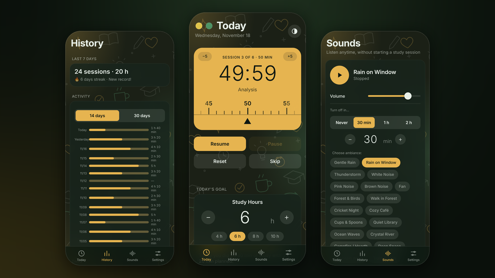

# 🌿 Karü  — Focus & Study Timer

**A calm, offline Pomodoro and productivity app to help you focus, study deeper and build a streak.**

🌐 **English** · [Español](README.es.md) · [Português](README.pt.md)

`focus` · `productivity` · `pomodoro` · `study timer` · `deep work` · `ambient sounds` · `white noise` · `habit streaks` · `offline` · `no ads` · `Android`

[⬇️ Download the APK](../../releases) · [☕ Support me on Ko-fi](https://ko-fi.com/karuapp)

---

## ✨ What is Karü ?

Karü  is a focus timer made for students and anyone who wants to get things done without distractions. Set your daily goal, let Karu build your study plan, press start, and concentrate — at your own pace.

**No accounts. No ads. No internet needed. Your data never leaves your phone.**

## 🚀 Features

- ⏱️ **Customizable Pomodoro timer** — choose your focus, short-break and long-break lengths, or pick a ready-made method: Classic (25/5), Long (50/10) or Anime (20/4).
- 🎯 **Daily study goal** — pick how many hours you want to study today and Karü  builds a plan of sessions for you. Tell it your free time slots and it tells you if your goal fits.
- 📈 **History & streaks** — see your last 7, 14 and 30 days, your day streak and your personal record to stay motivated.
- 🌧️ **23 ambient sounds** — rain on the window, thunderstorm, white / pink / brown noise, forest, cozy café, library, ocean waves, campfire, piano and more. Includes a sleep timer.
- 🕰️ **10 tick-tock sounds and 14 alarms** — with independent volume controls.
- ✅ **Tasks** — create tasks and link them to your sessions.
- 💡 **Smart suggestions** — recommended focus rhythm, best time of day and daily goal based on what you study (math, memorization, reading, creative work, practice…).
- 🎨 **Make it yours** — 20 color palettes, light/dark mode and fully custom colors.
- 💾 **Backup** — export and import your data any time.
- 🌍 **3 languages** — English, Español and Português.
- 🔒 **Private by design** — everything is stored only on your device.

## 📲 Installation (Android)

1. Go to the [Releases](../../releases) page.
2. Download the latest `.apk` file.
3. Open it on your phone and allow "install from unknown sources" if Android asks.

> 🛒 My goal is to publish Karu on Google Play. Until then, the APK is the way to try it!

## 🌱 A note from the developer

Hi! I'm **LuKz**, and this is one of my first projects. I'm a beginner, so Karü  is still growing and may have bugs or rough edges. If you find one, have an idea, or just want to say hi, please open an [Issue](../../issues) — I'd love to hear from you, and kind, constructive feedback means the world to me. 💛

## ☕ Support the project

Karü  is **100% free, ad-free and private**. Publishing on Google Play requires a developer account fee that I can't cover yet. If Karü  helps you in your day-to-day, you can chip in here:

👉 **[ko-fi.com/karuapp](https://ko-fi.com/karuapp)**

Sharing the app with a friend who studies is also a huge help! ⭐ A star on this repo helps too.

## 📄 License

© 2026 LuKz. All rights reserved. Please don't copy, redistribute or modify the app without permission.
