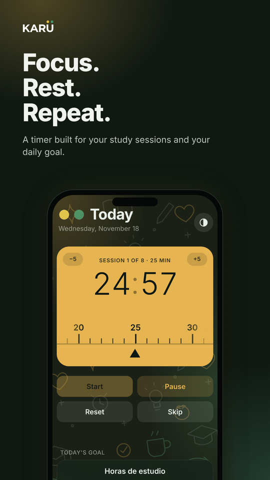
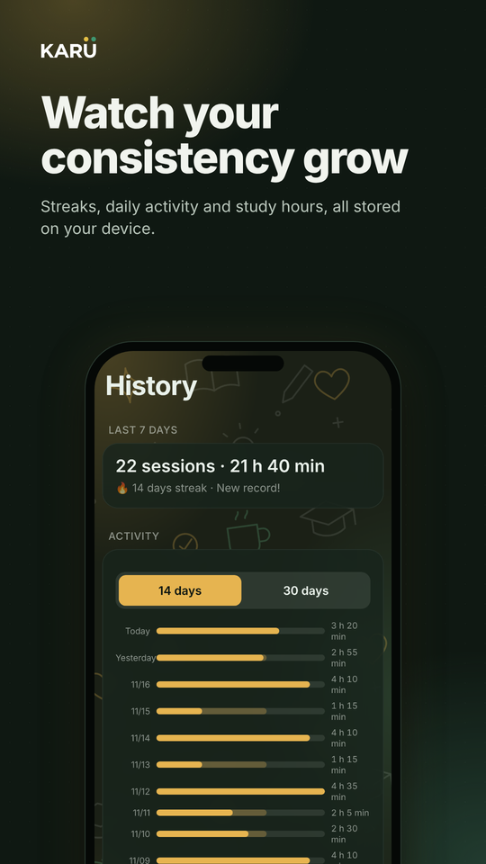
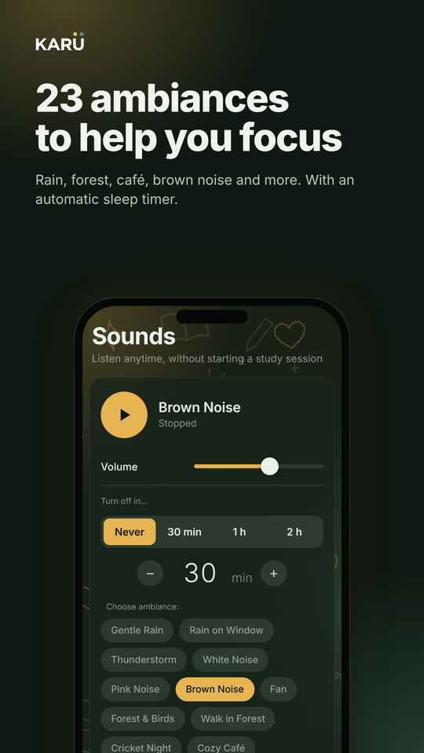
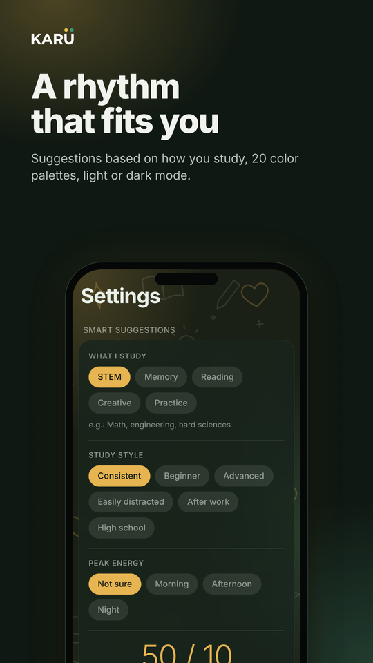

# 🌿 Karu — Study Timer

**A calm Pomodoro timer with no ads and no internet needed, so you can sit down, study and keep your streak going.**

🌐 **English** · [Español](README.es.md) · [Português](README.pt.md)

`focus` · `productivity` · `pomodoro` · `study timer` · `deep work` · `ambient sounds` · `white noise` · `habit streaks` · `offline` · `no ads` · `Android`

[⬇️ Download the APK](../../releases) · [☕ Support me on Ko-fi](https://ko-fi.com/karuapp)

---

## What is Karu?

Karu is a timer for studying. Tell it how many hours you want to study today, it builds your sessions, you press Start and get to work. Every session you finish adds to your history and your streak.

**No accounts, no ads and no internet. Everything stays on your phone.**

## Screenshots

   

## What's inside

- **A timer that fits you.** Pick the length of focus time, short breaks and long breaks, or use a ready-made method: Classic (25/5), Long (50/10) or Anime (20/4).
- **Daily goal.** Say how many hours you want to study today and Karu splits them into sessions. If you add your free time slots, it tells you whether your goal fits in the day.
- **History and streaks.** Check your last 7, 14 and 30 days, your day streak and your personal record.
- **23 ambient sounds.** Rain on the window, thunderstorm, white, pink and brown noise, forest, café, library, ocean waves, campfire, piano and more. You can set them to switch off on their own.
- **10 tick-tock sounds and 14 alarms**, each with its own volume.
- **Tasks** you can link to your sessions.
- **Suggestions** for rhythm, best time of day and daily goal based on what you study: math, memorizing, reading, something creative or practice.
- **Make it yours.** 20 color palettes, light and dark mode, and custom colors if none of them fits.
- **Backup.** Export and import your data whenever you want.
- **Three languages:** English, Spanish and Portuguese.

## Installation (Android)

1. Go to the [Releases](../../releases) page.
2. Download the latest `.apk` file.
3. Open it on your phone and, if Android asks, allow installing from unknown sources.

> My goal is to get Karu on Google Play. Until then, the APK is the way to try it.

## Who's behind it

Hi, I'm **LuKz**, and Karu is one of my first projects. I'm a beginner, so it may have bugs or rough edges. If you find one, have an idea, or just want to tell me how it went, open an [Issue](../../issues): I read every one, and kind feedback means a lot.

## Support the project

Karu is free, has no ads and is private. To publish it on Google Play I need to pay for a developer account, and I can't cover it yet. If it helps you day to day, you can buy me a coffee:

👉 **[ko-fi.com/karuapp](https://ko-fi.com/karuapp)**

Sharing it with a friend who studies, or leaving a star on this repo, helps a lot too.

## License

© 2026 LuKz. All rights reserved. Please don't copy, redistribute or modify the app without permission.
