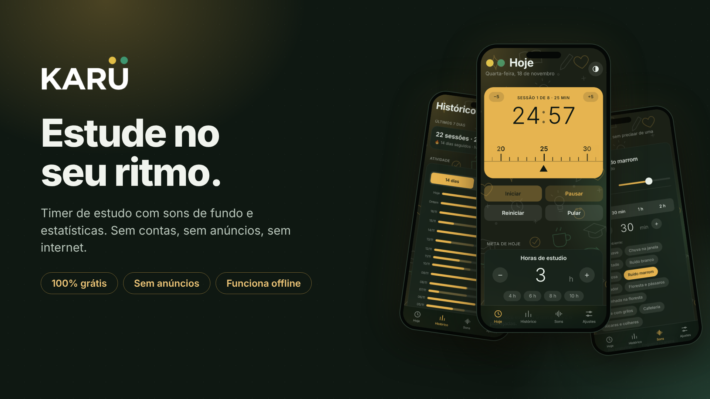
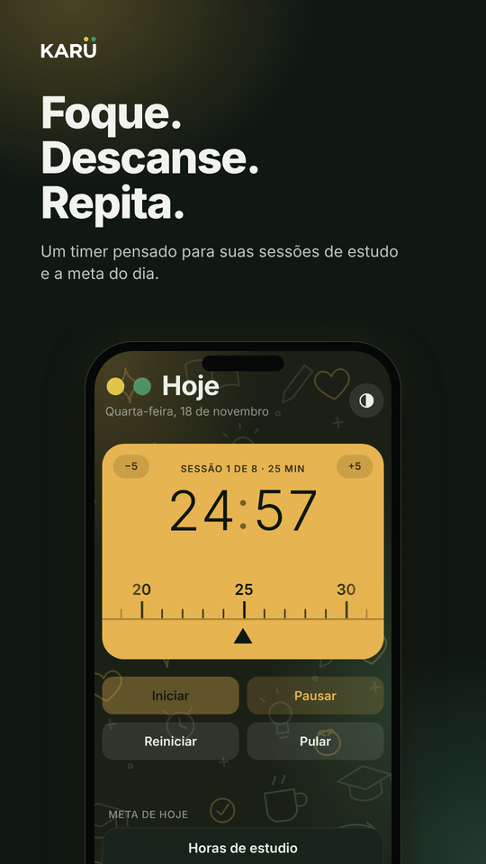
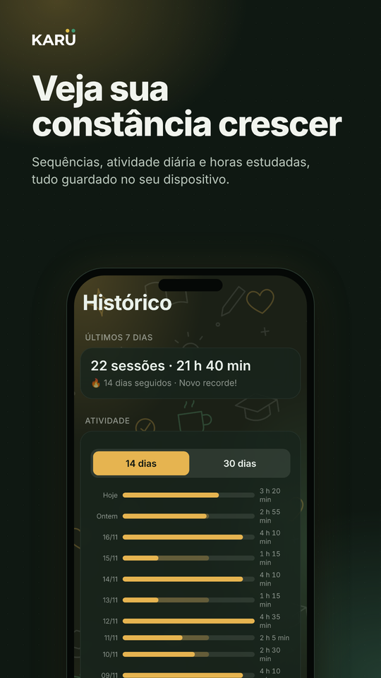
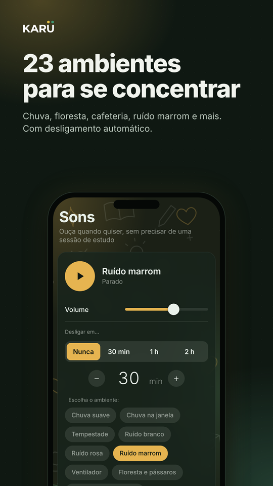
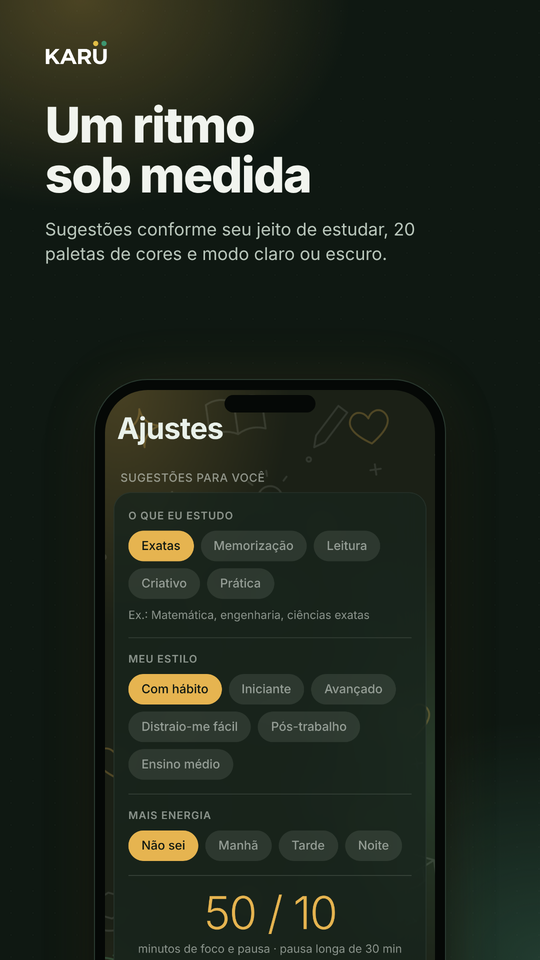

# 🌿 Karu — Timer de estudo

**Um Pomodoro tranquilo, sem anúncios e sem precisar de internet, para você sentar, estudar e manter a sequência.**

🌐 [English](README.md) · [Español](README.es.md) · **Português**

`foco` · `produtividade` · `pomodoro` · `timer de estudo` · `concentração` · `sons ambiente` · `ruído branco` · `sequência de dias` · `offline` · `sem anúncios` · `Android`

[⬇️ Baixar o APK](../../releases) · [☕ Apoie no Ko-fi](https://ko-fi.com/karuapp)

---

## O que é o Karu?

O Karu é um timer para estudar. Diga quantas horas você quer estudar hoje, ele monta as sessões, você aperta Iniciar e começa. Cada sessão concluída entra no seu histórico e na sua sequência.

**Sem contas, sem anúncios e sem internet. Tudo fica guardado no seu celular.**

## Capturas de tela

   

## O que tem no app

- **Timer do seu jeito.** Escolha a duração do foco, da pausa curta e da pausa longa, ou use um método pronto: Clássico (25/5), Longo (50/10) ou Anime (20/4).
- **Meta diária.** Diga quantas horas quer estudar hoje e o Karu divide em sessões. Se você informar seus horários livres, ele avisa se a meta cabe no dia.
- **Histórico e sequências.** Veja os últimos 7, 14 e 30 dias, seus dias seguidos e seu recorde.
- **23 sons ambiente.** Chuva na janela, tempestade, ruído branco, rosa e marrom, floresta, cafeteria, biblioteca, ondas, fogueira, piano e mais. Dá para programar o desligamento automático.
- **10 tique-taques e 14 alarmes**, cada um com seu volume.
- **Tarefas** que você pode associar às suas sessões.
- **Sugestões** de ritmo, melhor horário e meta diária de acordo com o que você estuda: matemática, memorização, leitura, algo criativo ou prática.
- **Com a sua cara.** 20 paletas de cores, modo claro e escuro, e cores livres se nenhuma te agradar.
- **Backup.** Exporte e importe seus dados quando quiser.
- **Três idiomas:** português, inglês e espanhol.

## Instalação (Android)

1. Acesse a página de [Releases](../../releases).
2. Baixe o arquivo `.apk` mais recente.
3. Abra no celular e, se o Android pedir, permita a instalação de fontes desconhecidas.

> Meu objetivo é chegar ao Google Play. Até lá, o APK é o jeito de testar.

## Quem faz

Oi, eu sou o **LuKz** e o Karu é um dos meus primeiros projetos. Sou iniciante, então ele pode ter bugs ou detalhes a melhorar. Se encontrar algum, tiver uma ideia ou quiser contar como foi sua experiência, abra uma [Issue](../../issues): eu leio todas, e um feedback gentil ajuda muito.

## Apoie o projeto

O Karu é gratuito, não tem anúncios e é privado. Para publicá-lo no Google Play preciso pagar uma conta de desenvolvedor, e por enquanto não consigo. Se ele te ajuda no dia a dia, você pode me pagar um café:

👉 **[ko-fi.com/karuapp](https://ko-fi.com/karuapp)**

Compartilhar com alguém que estuda ou deixar uma estrela no repositório também ajuda muito.

## Licença

© 2026 LuKz. Todos os direitos reservados. Por favor, não copie, redistribua nem modifique o app sem permissão.
